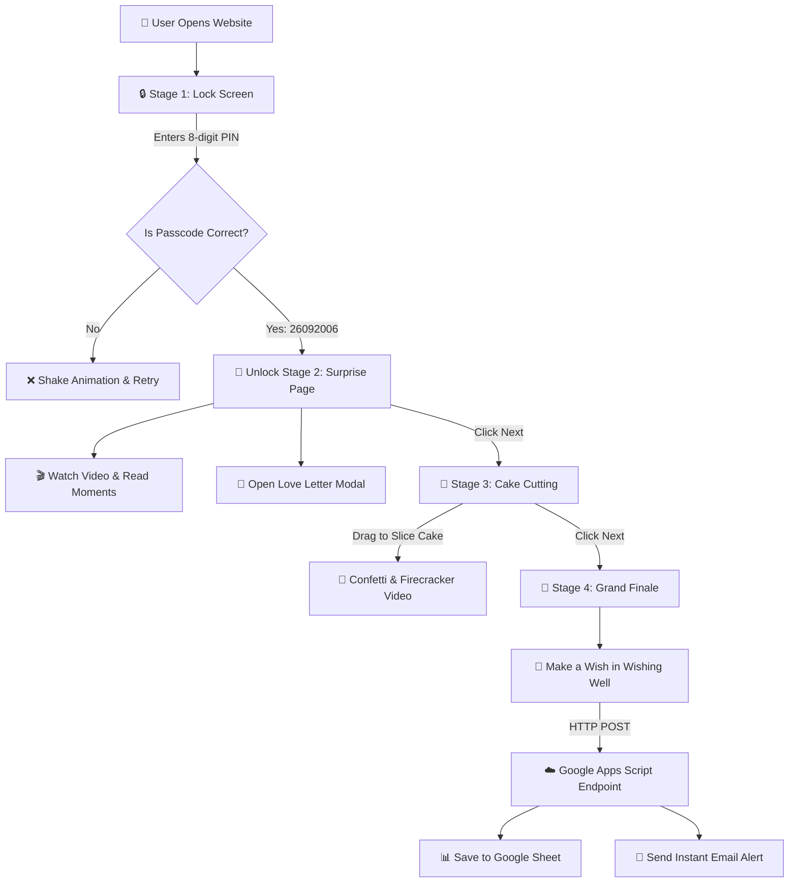

<div align="center">

# 🌸 ✨ Happy Birthday Little Snorlax ✨ 🌸
### 🎂 *A Magical, Interactive & Kawaii Birthday Surprise Web Experience* 💖

[](https://github.com/)
[](https://developer.mozilla.org/en-US/docs/Web/HTML)
[](https://developer.mozilla.org/en-US/docs/Web/CSS)
[](https://developer.mozilla.org/en-US/docs/Web/JavaScript)
[](https://web.dev/progressive-web-apps/)
[](https://www.netlify.com/)
[](https://developers.google.com/apps-script)

<p align="center">
  
</p>

> *"Because some people make the world beautiful just by being in it..."* 🌸✨

</div>

---

## 🎀 Table of Contents

- [🌸 Project Overview](#-project-overview)
- [✨ Key Features](#-key-features)
- [🛠️ Tech Stack & Architecture](#️-tech-stack--architecture)
- [📂 Project Structure](#-project-structure)
- [🔐 Passcode & Security (How to Change PIN)](#-passcode--security-how-to-change-pin)
- [💻 Installation & Running Locally](#-installation--running-locally)
- [🎨 How to Customize for Your Own Birthday Person](#-how-to-customize-for-your-own-birthday-person)
- [💌 Google Sheets & Email Notifications Setup](#-google-sheets--email-notifications-setup)
- [🚀 Deployment Guide](#-deployment-guide)
- [💖 Credits & Dedication](#-credits--dedication)

---

## 🌸 Project Overview

**Happy Birthday Little Snorlax** is an immersive, multi-stage web journey designed to make someone's birthday unforgettable! Rather than sending a plain text or greeting card, this web application creates a multi-page interactive adventure filled with:

- 🔒 **A secret PIN lock screen** with cute emoji keypad and sakura petals
- 📸 **A photo memory gallery** with heartfelt notes
- 🎬 **A private birthday video message**
- 💌 **An animated pop-up love letter**
- 🎂 **An interactive 3-tier SVG birthday cake** that you can slice with a knife cursor
- 🎆 **Celebratory firecrackers and confetti rain**
- 🌌 **A magical HTML5 canvas starfield** with shooting stars
- 🪄 **A real-time Magic Wishing Well** connected to Google Sheets & instant email alerts

---

## ✨ Key Features

### 1. 🔒 Stage 1: The Sakura Lock Screen
- **Secret 8-digit PIN verification**: Protects the surprise until unlocked.
- **Kawaii Emoji Keypad**: Custom pastel keys with adorable emoji labels (`💌`, `🥰`, `🌻`, `😘`, `💓`).
- **Interactive Passcode Dots**: Real-time feedback with playful bounce effects.
- **Shake Error Animation**: Playful wiggle animation and cute error prompt if the wrong PIN is entered.
- **Floating Butterflies & Sakura Petals**: Background particle effects to set a magical ambiance.

### 2. 🎀 Stage 2: Memory Lane & Surprise Video
- **"Your Beautiful Moments" Cards**: 3 curated polaroid-style picture cards with gentle hover tilt and heartfelt memory text.
- **Special Message Video Player**: Custom-styled HTML5 media player featuring an emotional birthday video.
- **Interactive Speech Bubbles & Cute Bear GIFs**: Playful animated stickers that dance on the screen.
- **"Read My Letter" Modal**: Pops open a vintage aesthetic love letter card with rich typography, wishes, and sweet personal messages.

### 3. 🎂 Stage 3: Interactive Cake Cutting Celebration
- **Multi-layered SVG Cake**: Handcrafted scalable vector graphic with glowing candles, frosting drips, and customizable icing text.
- **Drag-to-Cut Knife Cursor**: Users click or drag their mouse/finger across the cake to slice it!
- **Dynamic Cutting Progress Bar**: Visual progress indicator that fills up as the cake is cut.
- **Confetti Explosion & Firecracker Video**: Cutting the cake triggers colorful confetti bursts and plays a celebratory firecracker clip.
- **Age Milestone Badge**: Highlights the birthday milestone (e.g., *"20 Years of Pure Magic"*).

### 4. 🌟 Stage 4: Grand Finale & Magic Wishing Well
- **Cinematic Ambient Video Background**: Full-screen looping backdrop creating an ethereal nighttime vibe.
- **Interactive Starfield Canvas**: Dynamic twinkling stars and animated shooting star effects across the night sky.
- **Magic Wishing Well**: The birthday person can type their deepest birthday wish.
- **Serverless Google Apps Script Integration**: Submitting the wish instantly records it in a Google Sheet and sends an email notification to you!
- **"Thank You" Modal & Replay Option**: A warm closing popup with an option to loop back to the beginning.

### 5. 📱 Progressive Web App (PWA)
- **Installable on Mobile & Desktop**: Adds a cute custom app icon directly to home screens.
- **Offline Support**: Handled via `sw.js` (Service Worker) caching.
- **High-Performance**: Preloaded fonts, optimized video posters, and lazy-loading media assets.

---

## 🛠️ Tech Stack & Architecture

### Frontend
| Component | Technology | Description |
| :--- | :--- | :--- |
| **Markup** | HTML5 Semantic | Clean, accessible structure with Open Graph & Twitter meta tags |
| **Styling** | Vanilla CSS3 | Glassmorphism, CSS keyframe animations, gradients, responsive flexbox/grid |
| **Typography** | Google Fonts | `Nunito`, `Dancing Script`, `Pacifico`, and `Great Vibes` |
| **Logic** | Modern JavaScript (ES6+) | Page state transitions, keypad handlers, canvas particle engine |
| **Cake Cutting** | SVG + Pointer Events | Custom vector graphics with interactive cutting logic |
| **Starfield** | HTML5 `<canvas>` | Twinkling stars and shooting star particle physics |
| **PWA** | Web App Manifest & Service Worker | Offline caching and standalone installable app experience |

### Backend & Cloud
| Component | Technology | Description |
| :--- | :--- | :--- |
| **Serverless API** | Google Apps Script | Webhook handling HTTP POST requests |
| **Database** | Google Sheets | Stores user wishes, timestamps, IP, and action logs |
| **Notifications** | Gmail API (Apps Script) | Sends real-time email alerts when a wish is made or page unlocked |
| **Hosting** | Netlify | Ultra-fast CDN hosting with custom headers & redirect rules |

### 📐 System Architecture Diagram



---

## 📂 Project Structure

```bash
Birthday wish 2/
├── 📄 index.html              # Main multi-page single-page application (SPA)
├── 🎨 styles.min.css          # Optimized CSS styling, animations & responsive media queries
├── ⚡ script.min.js          # Core app logic (keypad, cake cutting, canvas, analytics)
├── ☁️ apps_script.js          # Google Apps Script code for Google Sheets & email alerts
├── 📱 manifest.json           # PWA configuration (name, icons, colors)
├── 🛠️ sw.js                   # Service Worker for offline caching & instant load
├── ⚙️ netlify.toml            # Netlify build and cache headers configuration
├── 📄 _headers                # HTTP caching and security headers
├── 📄 _redirects              # Netlify client-side routing redirects
├── 🐍 optimize.py             # Python script for asset & HTML optimization
├── 🤖 robots.txt              # Search engine crawler policies
├── 🗺️ sitemap.xml             # XML sitemap
│
├── 📁 image/                  # Images, stickers & GIF assets
│   ├── anime_girl.png         # Cute anime mascot
│   ├── anime_girl_surprise.png# Mascot for keypad lock
│   ├── icon.jpeg              # App icon for PWA
│   ├── Fire craker.mp4        # Cake celebration video
│   ├── happy birthday wish.mp4# Main special birthday video
│   ├── 📁 background/         # Video & image backgrounds for each stage
│   │   ├── back_1.mp4 & poster.jpg # Stage 4 finale backdrop
│   │   ├── back_2.mp4 & poster.jpg # Letter modal backdrop
│   │   ├── back_3.mp4 & poster.jpg # Stage 3 cake page backdrop
│   │   ├── back_4.jpg              # Stage 2 moments backdrop
│   │   ├── back_5.mp4 & poster.jpg # Thank you modal backdrop
│   │   └── lock_back.png           # Stage 1 lock backdrop
│   ├── 📁 gif/                # Cute animated stickers & reaction GIFs (gif1 to gif7)
│   └── 📁 Image Birthday Girl or Boy/
│       ├── img1.jpeg          # Photo 1: "Your Smile Says It All"
│       ├── img2.jpeg          # Photo 2: "Together Vibes"
│       └── img3.jpeg          # Photo 3: "Pretty Soul"
│
└── 📁 video/                  # Extra backup videos for custom wishes
    ├── Video2.mp4
    ├── Video3.mp4
    └── video4.mp4
```

---

## 🔐 Passcode & Security (How to Change PIN)

The surprise is locked behind an 8-digit passcode keypad.

### 🔑 Default Passcode
```text
26092006
```
*(Represents birthdate format: DD/MM/YYYY — 26 September 2006)*

### 📝 How to Change the Passcode:
1. Open [`script.min.js`](file:///e:/ALL%20PROJECT/Birthday%20wish%202/script.min.js).
2. Locate line 70 (or search for `const CORRECT`):
   ```javascript
   const CORRECT = "26092006";
   ```
3. Change `"26092006"` to any 8-digit passcode you desire (for example, `"15082005"`):
   ```javascript
   const CORRECT = "15082005";
   ```
4. Save the file. Done!

> [!TIP]
> If you prefer a 4-digit or 6-digit passcode instead of 8:
> - Change `const CORRECT = "1234";` in [`script.min.js`](file:///e:/ALL%20PROJECT/Birthday%20wish%202/script.min.js).
> - Adjust the passcode length check from `8` to `4` in `handleKeyPress()` in [`script.min.js`](file:///e:/ALL%20PROJECT/Birthday%20wish%202/script.min.js).
> - Update the number of `.passcode-dot` elements in [`index.html`](file:///e:/ALL%20PROJECT/Birthday%20wish%202/index.html).

---

## 💻 Installation & Running Locally

This project is built with vanilla web technologies, requiring **no heavy build tools or npm installation**!

### Method 1: Direct Browser Launch
Simply double-click [`index.html`](file:///e:/ALL%20PROJECT/Birthday%20wish%202/index.html) to open it in your favorite browser (Chrome, Edge, Firefox, Safari).

### Method 2: VS Code Live Server (Recommended)
1. Open the project folder in VS Code.
2. Install the **Live Server** extension.
3. Right-click on [`index.html`](file:///e:/ALL%20PROJECT/Birthday%20wish%202/index.html) and select **"Open with Live Server"**.
4. The site will launch at `http://127.0.0.1:5500`.

### Method 3: Python Local Server
If you have Python installed, open your terminal inside the project directory and run:
```bash
python -m http.server 8080
```
Then visit: `http://localhost:8080`

### Method 4: Node.js `npx serve`
```bash
npx serve .
```

---

## 🎨 How to Customize for Your Own Birthday Person

You can easily adapt this project for your best friend, partner, sibling, or family member!

### 1. 🏷️ Change Name & Titles
Open [`index.html`](file:///e:/ALL%20PROJECT/Birthday%20wish%202/index.html) and search/replace:
- `"Little Snorlax"` ➔ Your person's name / cute nickname (e.g. `"Emma"`, `"Princess"`, `"Teddy"`).
- Update the SVG Cake text (around line 247):
  ```html
  <text x="170" y="200" ...>Happy Birthday YourName!</text>
  ```

### 2. 🎂 Change the Age Milestone
If they are celebrating a different birthday (e.g. 18th, 21st, 25th):
- Search in [`index.html`](file:///e:/ALL%20PROJECT/Birthday%20wish%202/index.html) for `"20th"` and `"20 Years"`:
  ```html
  <div class="age-badge">🎀 21 Years of Pure Magic 🎀</div>
  <div class="cake-label">Happy 21st Birthday, Little Snorlax! 🥳</div>
  ```

### 3. 📸 Replace the Photos
Replace the files inside [`image/Image Birthday Girl or Boy/`](file:///e:/ALL%20PROJECT/Birthday%20wish%202/image/Image%20Birthday%20Girl%20or%20Boy/):
- `img1.jpeg`: First photo card (Smile moment)
- `img2.jpeg`: Second photo card (Together vibes)
- `img3.jpeg`: Third photo card (Aesthetic soul)

*(Keep the same filenames and formats for effortless drop-in replacement!)*

### 4. 🎬 Replace the Birthday Video
Replace the main video file at [`image/happy birthday wish.mp4`](file:///e:/ALL%20PROJECT/Birthday%20wish%202/image/happy%20birthday%20wish.mp4) with your own edited birthday video or recorded greeting.

### 5. 💌 Personalize the Love Letter
In [`index.html`](file:///e:/ALL%20PROJECT/Birthday%20wish%202/index.html) (inside `<ul class="wish-list">` around lines 535–565):
- Modify the personal memories, favorite inside jokes, and heartfelt wishes.
- Update the sender signature:
  ```html
  <strong>Your friend (YourName 💗)</strong> 💌
  ```

---

## 💌 Google Sheets & Email Notifications Setup

When your special someone makes a wish in the **Magic Wishing Well**, the web app forwards their wish directly to your personal Google Sheet and emails it straight to your inbox!

### ⚙️ Step-by-Step Setup:
1. Go to [Google Sheets](https://sheets.new) and create a new blank spreadsheet.
2. In the top menu, navigate to **Extensions** ➔ **Apps Script**.
3. Delete any default code inside the script editor.
4. Copy the entire contents of [`apps_script.js`](file:///e:/ALL%20PROJECT/Birthday%20wish%202/apps_script.js) and paste it into the editor.
5. In [`apps_script.js`](file:///e:/ALL%20PROJECT/Birthday%20wish%202/apps_script.js), check the recipient email address (or update it with your own email where you want to receive wish alerts).
6. Click the 💾 **Save** icon.
7. Click **Deploy** ➔ **New deployment**:
   - **Select type**: Web app
   - **Description**: Birthday Wishes Backend
   - **Execute as**: Me
   - **Who has access**: Anyone
8. Click **Deploy** and authorize permissions when prompted.
9. Copy your new **Web App URL** (ends with `/exec`).
10. Open [`script.min.js`](file:///e:/ALL%20PROJECT/Birthday%20wish%202/script.min.js) and replace the existing URL at line 2 with your new Web App URL:
    ```javascript
    "https://script.google.com/macros/s/YOUR_DEPLOYMENT_ID/exec"
    ```

Now, every wish submitted will be logged into your spreadsheet and emailed to you in real time! ✨

---

## 🚀 Deployment Guide

Publish your birthday surprise online so they can access it on their smartphone with a single link!

### 🌐 Deploy on Netlify (Fastest)
1. Create a free account on [Netlify](https://www.netlify.com/).
2. Drag and drop the entire `Birthday wish 2` folder directly into the Netlify Dashboard (**Sites** ➔ **Add new site** ➔ **Deploy manually**).
3. Netlify will automatically detect [`netlify.toml`](file:///e:/ALL%20PROJECT/Birthday%20wish%202/netlify.toml), [`_headers`](file:///e:/ALL%20PROJECT/Birthday%20wish%202/_headers), and [`_redirects`](file:///e:/ALL%20PROJECT/Birthday%20wish%202/_redirects).
4. Get your live URL (e.g., `https://happy-birthday-surprise.netlify.app`) and share it with your birthday star! 🎁

### 🐙 Deploy on GitHub Pages
1. Push this folder to a GitHub repository.
2. Go to **Settings** ➔ **Pages**.
3. Select `main` (or `master`) branch as the source and click **Save**.
4. Your site will be live at `https://yourusername.github.io/repository-name/`.

---

## 💖 Credits & Dedication

- **Created with**: Endless care, cute aesthetics, and love 🌸
- **Art & Aesthetics**: Kawaii Anime & Studio Ghibli inspired pastel aesthetics
- **Sound & Media**: Celebratory soundscapes, memories, and firecracker animations

<div align="center">

---

### 🌸 *"May your year ahead be as bright, joyful, and wonderful as you are!"* 🎂✨

**Happy Birthday Little Snorlax!** 💖

</div>
